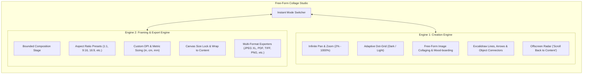

# Free-Form Collage Builder & Canvas Studio
## Product Requirements & Technical Feature Specification Document

> **Document Type:** Comprehensive Feature Specification & System Requirements  
> **Target Audience:** Engineering Leads, Full-Stack / Frontend Developers, and UI/UX Engineers  
> **Purpose:** Hand this document to an engineering team to build a complete, production-grade version of this application from scratch. Every feature is specified as a clean, forward-looking requirement without legacy version baggage.

---

## 1. Architectural Decisions For The Engineering Team

> [!IMPORTANT]
> ### Architectural Decisions for Your Rebuild Team
> Before starting the rebuild from scratch, review this specification with your developer to align on three key decisions:
> 
> 1. **Rendering Stack:** Do you want to build on **HTML5 Canvas 2D with a Layered Stage** (recommended for lightweight zero-dependency control) or adopt a scene-graph library like **Konva.js / Pixi.js**?
> 2. **AI Background Removal:** Should the team keep the legacy **color-distance heuristic algorithm**, or upgrade to a modern in-browser neural model (e.g. `@imgly/background-removal` via WebAssembly/ONNX)?
> 3. **Framework Choice:** The blueprint recommends **React + Vite + TypeScript + Zustand + Immer** for strict typing of `ImageObject` vs `LineObject` discriminated unions and robust state snapshots.

---

## 2. Product Overview & Dual-Engine Concept

**Free-Form Collage Builder & Canvas Studio** is an offline-first, client-side visual composition studio that operates in two complementary workspaces:



### 2.1 Workspace 1: The Creation Engine (Infinite Whiteboard)
- **Role:** Ideation, layout exploration, free-form image juxtaposition, mood-boarding, and visual diagramming.
- **Characteristics:** Unbounded Cartesian 2D coordinates, cursor-anchored pan/zoom, responsive dot-grid backdrop, and freehand annotations.

### 2.2 Workspace 2: The Framing & Export Engine (Production Stage)
- **Role:** Cropping, framing, social media sizing, and production-ready exports.
- **Characteristics:** Bounded composition area, aspect ratio constraints, metric print sizing (DPI-aware), auto-expanding or size-locked boundaries, and high-fidelity multi-format rendering.

---

## 3. Recommended Modern System Architecture

```
┌────────────────────────────────────────────────────────────────────────┐
│                          APPLICATION STACK                             │
├────────────────────────────────────────────────────────────────────────┤
│ UI Framework:      React 18+ (or Svelte 5 / Vue 3) + TypeScript        │
│ Build Tool:        Vite                                                │
│ State Store:       Zustand + Immer (Transaction-based history)         │
│ Styling & System:  Tailwind CSS + Radix UI Primitives + Lucide Icons   │
│ Rendering Model:   Layered Canvas Architecture:                        │
│                    - Background Layer: CSS-transformed Dot Grid       │
│                    - Scene Stage Layer: Raster images & vector lines   │
│                    - Interactive Overlay Layer: Guidelines, Marquee,   │
│                      Crop Mask, Resize Handles                         │
│ Web Workers:       Sobel gradient filter, Dijkstra pathfinding,        │
│                    binary PDF/TIFF/JXL encoder threads                 │
└────────────────────────────────────────────────────────────────────────┘
```

---

## 4. Core Data Models (TypeScript Schemas)

```typescript
export type Unit = 'px' | 'in' | 'cm' | 'mm';
export type WorkMode = 'unlimited' | 'standard';
export type CanvasPreset = 'auto' | '1:1' | '9:16' | '16:9' | '3:4' | '4:3' | 'custom' | string;
export type ExportFormat = 'jxl' | 'jpeg' | 'png' | 'webp' | 'avif' | 'pdf' | 'svg' | 'tiff';
export type ImportFormat = 'image/jpeg' | 'image/png' | 'image/webp' | 'image/avif' | 'image/jxl' | 'image/svg+xml' | 'image/tiff';
export type StrokeStyle = 'solid' | 'dashed' | 'dotted';
export type LineType = 'straight' | 'curve' | 'elbow';
export type Arrowhead = 'none' | 'arrow' | 'triangle' | 'circle' | 'diamond' | 'bar';
export type BindingEdge = 'top' | 'bottom' | 'left' | 'right' | 'center';
export type ToolMode = 'select' | 'pan' | 'line' | 'arrow' | 'crop_rect' | 'crop_freeform' | 'crop_magnetic';

export interface Point {
  x: number;
  y: number;
}

export interface BoundingBox {
  x: number;
  y: number;
  width: number;
  height: number;
}

export interface ObjectBinding {
  elementId: string;
  edge: BindingEdge;
}

export interface BaseCanvasObject {
  id: string;
  groupId: number | null;
  opacity: number;         // 0.0 to 1.0
  rotation: number;        // degrees -180 to 180
  flipH: boolean;
  flipV: boolean;
  x: number;               // Normalized bounding box top-left
  y: number;
  width: number;
  height: number;
}

export interface ImageObject extends BaseCanvasObject {
  type: 'image';
  element: HTMLImageElement;
  dataUrl: string;         // Serialized Base64 data (PNG/JXL)
  origWidth: number;
  origHeight: number;
  mimeType: string;
}

export interface LineObject extends BaseCanvasObject {
  type: 'line';
  points: Point[];         // Multi-point spline / segment points
  strokeColor: string;     // Hex color (#ffffff)
  strokeWidth: number;     // Width in px (1 - 20)
  strokeStyle: StrokeStyle;
  roughness: number;       // 0 = sharp, 1 = hand-drawn, 2 = rough sketch
  roughSeed: number;
  lineType: LineType;
  startArrowhead: Arrowhead;
  endArrowhead: Arrowhead;
  startBinding: ObjectBinding | null;
  endBinding: ObjectBinding | null;
}

export type CanvasObject = ImageObject | LineObject;

export interface ViewportState {
  workMode: WorkMode;
  // Creation Engine (Unlimited Canvas)
  ulPanX: number;
  ulPanY: number;
  ulZoom: number;          // Clamped 0.02 to 10.0
  unlimitedTheme: 'dark' | 'light';
  // Framing Engine (Standard Canvas)
  zoomLevel: number;       // Clamped 0.05 to 3.0
  canvasMode: CanvasPreset;
  canvasLocked: boolean;
  lockedCanvasW: number | null;
  lockedCanvasH: number | null;
  customCanvasW: number | null;
  customCanvasH: number | null;
  renderOffsetX: number;
  renderOffsetY: number;
}

export interface GlobalSettings {
  spacing: number;            // Vertical stacking gap (0 - 200px)
  horizontalSpacing: number;  // Horizontal stacking gap (0 - 200px)
  bgColor: string;            // Canvas background color (#ffffff)
  transparentBg: boolean;     // Transparency toggle
  exportFormat: ExportFormat;
  exportQuality: number;      // 10 to 100
  resizeMode: 'none' | 'widest' | 'narrowest';
  isSnapping: boolean;
  isResizeSnapping: boolean;
}

export interface WorkspaceFile {
  formatVersion: 2;
  savedAt: string;
  images: Array<CanvasObject>;
  settings: GlobalSettings & ViewportState & { groupCounter: number };
}
```

---

## 5. Detailed Feature Specifications

### 5.1 Dual-Engine Viewport & Navigation System

#### Creation Engine (Infinite Whiteboard)
1. **Infinite Pan & Zoom:**
   - Pan by dragging on empty canvas, holding Spacebar, or middle-mouse drag.
   - Zoom with mouse scroll wheel centered dynamically on cursor coordinates:
     $$\text{worldX} = \frac{\text{mouseX} - \text{panX}}{\text{zoom}}, \quad \text{worldY} = \frac{\text{mouseY} - \text{panY}}{\text{zoom}}$$
   - Zoom clamped between $2\%$ ($0.02\times$) and $1000\%$ ($10.0\times$).
2. **Adaptive Dot-Grid Background:**
   - Base grid frequency $40\text{px} \times \text{zoom}$.
   - Dynamically doubles or halves dot intervals to guarantee spacing stays between $15\text{px}$ and $80\text{px}$ on screen.
   - Dual theme support: Dark mode (`#020617` background, slate dots) and Light mode (`#f8fafc` background, subtle gray dots).
3. **Viewport Shortcuts & Radar Indicator:**
   - **Fit Content:** Computes tight bounding box of all objects plus 80px margin and centers camera.
   - **Reset View:** Returns camera to origin $(0, 0)$ at $100\%$ scale.
   - **"Scroll Back to Content" Floating Button:** Detects when all scene objects are outside the visible viewport boundaries plus $50\text{px}$ buffer; displays an animated pill that smoothly animates camera back to content when clicked.

#### Framing & Export Engine (Bounded Studio)
1. **Aspect Ratio Presets:**
   - `Auto`: Canvas tightly encloses the scene content.
   - Standard presets: `1:1`, `9:16`, `16:9`, `3:4`, `4:3`.
   - `Custom`: Displays dimension and metric controls.
2. **Precision Metric Sizing & DPI:**
   - Units: `px`, `in`, `cm`, `mm`.
   - DPI selector: 72 to 1200 DPI (defaults to 300 DPI for print).
   - Dynamic Custom Ratio field: User can input arbitrary ratios (e.g. `21:9`).
3. **Canvas Size Lock:**
   - Toggle switch freezes canvas dimensions. Objects moved outside canvas are visually clipped and excluded from exports. Normalizes internal coordinates to prevent visual displacement upon toggling.
4. **Wrap Canvas to Content:**
   - Shifts all objects so minimum $(X, Y)$ is at $(0, 0)$, resets canvas mode to `auto`, and fits canvas to exact visible content bounds.
5. **Floating Zoom & Metrics Toolbar:**
   - Displays real-time canvas pixel dimensions ($W \times H$).
   - Fit to Screen button, zoom decrement/increment buttons, and canvas lock shortcut.

---

### 5.2 Asset Ingestion & Multi-Format Compatibility

#### File Import Formats
- **Standard Raster:** PNG, JPEG, WebP, AVIF, GIF, SVG.
- **JPEG XL Support (`.jxl`):** Direct import of JPEG XL images via native browser support or client-side WASM decoder fallback (`libjxl`).
- **TIFF Support:** Direct import of uncompressed and LZW TIFF files.
- **Ingestion Mechanisms:**
  - Multi-file system file picker (`image/*, .jxl, .tiff`).
  - Native Drag-and-Drop directly onto canvas with mouse-coordinate placement.
  - Clipboard paste (`Ctrl + V`) for screenshot and image buffer ingestion.

#### Stacking & Layout Automation
1. **Auto-Resize Upon Import:**
   - `Original Size`: Retains native dimensions.
   - `Match Widest`: Automatically scales new image to match the widest existing image.
   - `Match Smallest`: Automatically scales new image to match the narrowest existing image.
2. **Re-Stack Commands:**
   - **Re-Stack Vertically:** Sets $X = 0$, sorts by $Y$, stacks top-to-bottom using vertical spacing.
   - **Re-Stack Horizontally:** Sets $Y = 0$, sorts by $X$, stacks left-to-right using horizontal spacing.
3. **Proximity-Based Spacing Sliders:**
   - Vertical Spacing (0 – 200px): Groups objects into rows within $\pm 50\text{px}$ proximity and scales inter-row distance in real-time.
   - Horizontal Spacing (0 – 200px): Groups objects into columns within $\pm 50\text{px}$ proximity and scales inter-column distance in real-time.

---

### 5.3 Object Transformation & Manipulation

1. **Selection Modes:**
   - Single Click: Selects object, reveals 8 bounding box resize handles.
   - Shift + Click: Additive/subtractive multi-object selection.
   - Marquee Drag: Dashed bounding box selecting all intersected objects.
   - Select All (`Ctrl + A`) and Deselect (`Escape`).
2. **8-Point Bounding Resize:**
   - Handles: Top-Left, Top-Center, Top-Right, Mid-Left, Mid-Right, Bottom-Left, Bottom-Center, Bottom-Right.
   - Corner handles preserve aspect ratio by default; edge handles stretch axes independently.
   - Minimum clamp: $20\text{px} \times 20\text{px}$.
3. **Continuous Rotation Engine:**
   - Rotation from $-180^\circ$ to $+180^\circ$.
   - Interactive slider, direct degree numerical input, step buttons ($-90^\circ, +90^\circ, -15^\circ, +15^\circ$), and "Reset to 0°".
   - Trigonometrically projected bounding box computation ($\cos \theta, \sin \theta$) to guarantee non-clipped rendering.
4. **Precision Object Sizing Dialog:**
   - Fixed Ratio Presets: `1:1`, `3:4`, `4:3`, `9:16`, `16:9`.
   - "Fit by Width" (keeps width, computes height) vs "Fit by Height" (keeps height, computes width).
   - Numerical W/H inputs with unit conversion (`px`, `in`, `cm`, `mm`), aspect lock, and "Reset to Original".
5. **Mirroring & Opacity:**
   - Flip Horizontal and Flip Vertical mirrored across selection centroid.
   - Real-time opacity slider from $0\%$ to $100\%$.
6. **Duplication, Deletion & Nudge:**
   - Duplicate (`Ctrl + D`): Clones selection offset by $+20\text{px}, +20\text{px}$.
   - Delete (`Delete` / `Backspace`): Removes selection.
   - Nudge: Arrow keys move $1\text{px}$; `Shift + Arrow` moves $10\text{px}$.

---

### 5.4 Layer Management & Grouping

1. **Collapsible Objects/Layers Sidebar:**
   - Displays all canvas elements ordered from Front (top of list) to Back (bottom of list).
   - Live thumbnail previews for images; glyph indicators for lines/arrows.
   - Shows element dimensions, stroke attributes, and group badges.
2. **Interactive Drag-and-Drop Reordering:**
   - Dragging layers in the panel reveals insertion indicator bars (`drop-before` / `drop-after`).
   - Releasing updates scene z-index order and registers an undo step.
3. **Z-Index Controls:**
   - Bring to Front (`array.push`).
   - Send to Back (`array.unshift`).
   - Bring Forward (`]` key): Swaps with upper sibling.
   - Send Backward (`[` key): Swaps with lower sibling.
4. **Grouping System:**
   - Group (`Ctrl + G`): Assigns shared unique `groupId`.
   - Ungroup (`Ctrl + Shift + G`): Clears `groupId`.
   - Clicking any grouped item selects the entire group with a shared cyan dashed bounding box.

---

### 5.5 Intelligent Snapping & Alignment Engine

1. **Object-to-Object Edge & Center Snapping:**
   - Snapping distance threshold: $\text{threshold} = 15\text{px} / \text{zoom}$.
   - Aligns moving objects to all other visible objects:
     - Left-to-Left, Left-to-Right, Right-to-Right, Right-to-Left.
     - Top-to-Top, Top-to-Bottom, Bottom-to-Bottom, Bottom-to-Top.
     - CenterX-to-CenterX, CenterY-to-CenterY, Center-to-Edge.
   - Draws dashed magenta guideline overlays (`#ec4899`).
2. **Resize Snapping:**
   - Snaps the specific handle/edge being resized to adjacent object edges and centerlines.
3. **Canvas Boundary Snapping:**
   - In bounded canvas mode, snaps to canvas boundaries ($X = 0, W/2, W$; $Y = 0, H/2, H$).

---

### 5.6 Cropping Suite & Intelligent Scissors

#### Crop Modes
1. **Rectangular Crop:** Drag marquee over target image; dims background; crops to rectangle.
2. **Freeform Lasso Crop:** Freehand polygon drawing around target subject.
3. **Magnetic Lasso (Intelligent Scissors Edge-Snapping):**
   - **Gaussian Blur Pre-filter:** $3 \times 3$ kernel to suppress sensor noise.
   - **Multi-Channel Sobel Gradients:** Evaluates max gradient across R, G, B, and Luminance channels:
     $$M = \max(G_R, G_G, G_B, G_{\text{gray}})$$
   - **Cost Map Calculation:** Inverts edge magnitude so high edges form zero-cost paths:
     $$\text{Cost}(x, y) = 255 - M_{\text{norm}}(x, y) + 1$$
   - **Live A\* / Dijkstra Pathfinding:** Computes optimal edge-following path between last fixed anchor point and live cursor position in real-time.
   - **Anchor Snapping:** Clicking searches within configurable radius (3–30px) and snaps anchor to strongest edge. Double-click or clicking start anchor closes the loop.
   - **Path Post-Processing:** Applies Douglas-Peucker simplification ($\epsilon = 1.2$) and Chaikin corner-cutting subdivision smoothing (2 iterations).

#### Crop Execution Actions
- **Crop:** In-place replacement of image with cropped region.
- **Duplicate:** Leaves original image intact; spawns cropped region as a new object.
- **Cut:** Spawns cropped region as a new object and transparently cuts a hole out of the original image.

---

### 5.7 Automated Background Removal

- **Engine Option A (Heuristic):** Samples corners for background color; computes Manhattan color distance ($\Delta C = |\Delta R| + |\Delta G| + |\Delta B|$); zeroes alpha for pixels below threshold (`40`).
- **Engine Option B (AI Neural Segmentation - Recommended):** WebAssembly/ONNX model execution in-browser (e.g. `@imgly/background-removal` or RMBG-1.4) producing studio-quality alpha masks in 1 click.
- **Output:** Updates image element in-place with transparent PNG/WebP buffer.

---

### 5.8 Excalidraw-Style Vector Lines, Arrows & Connectors

1. **Tools & Modes:**
   - Select (`V`), Line (`L`), Arrow (`A`).
   - Sticky Tool Lock: Keeps tool active after completing line if toggled on.
2. **Pre-Drawing Customizer:**
   - Stroke Color picker, Width slider (1–20px), Style selector (Solid, Dashed, Dotted).
   - Hand-drawn Roughness: `0` (Clean vector), `1` (Two-pass jitter), `2` (Three-pass rough sketch) using seeded pseudo-random noise.
   - Arrowhead terminators: `none`, `arrow`, `triangle`, `circle`, `diamond`, `bar`.
3. **Routing Engines:**
   - **Straight Line:** Direct linear vector between points.
   - **Curve:** Quadratic bezier spline through multiple points. Double-click completes line; `Shift + Double-Click` inserts a new node on an existing curve segment.
   - **Elbow Line:** 90-degree orthogonal routing for clean technical diagrams.
4. **Dynamic Object Binding (Magnetic Connectors):**
   - Hovering line endpoints near an image highlights 5 connection ports (`top`, `bottom`, `left`, `right`, `center`).
   - Snapping binds the endpoint to the target object.
   - When the bound image is moved, resized, or rotated, bound endpoints dynamically re-anchor in real-time.

---

### 5.9 Production Multi-Format Export Engine

The exporter must support full canvas export and tight selected-objects-only export across all of the following formats:

1. **JPEG XL (`.jxl`):**
   - Next-generation ultra-efficient image format.
   - Supports lossless alpha transparency or high-quality lossy compression (quality slider 10–100%).
   - Integrated via native browser encoding or client-side WebAssembly encoder (`libjxl`).
2. **PNG (`.png`):** 24-bit lossless raster export with full alpha channel.
3. **JPEG (`.jpg`):** Lossy export with quality slider (10% to 100%). Automatically draws background fill color to prevent black transparency artifacts.
4. **WebP (`.webp`):** Modern lossy and lossless web format with transparency.
5. **AVIF (`.avif`):** High-efficiency modern compressed format.
6. **Native PDF 1.4 Binary Compiler (Zero-Dependency):**
   - Compiles valid **PDF 1.4 byte specification** directly in memory.
   - Generates Catalog (`1 0 obj`), Pages tree (`2 0 obj`), Page specification (`3 0 obj`), Content Stream with full-bleed transform matrix (`4 0 obj`), and DCTDecode JPEG stream (`5 0 obj`).
   - Calculates exact byte offsets for the `xref` cross-reference table and `trailer` dictionary.
7. **Native TIFF 6.0 Binary Writer (Zero-Dependency):**
   - Assembles uncompressed RGB pixel strips into standard **TIFF 6.0 format**.
   - Generates 8-byte Little-Endian header (`0x4949`, version `42`) and Image File Directory (IFD) with 12 standard tags.
8. **SVG Vector Document (`.svg`):**
   - Emits structured SVG XML document wrapping raster images with transform attributes, rotations, and clean vector `<path>` lines and arrowheads.
9. **Transparency Warning:** Displays amber notice banner when user selects `Transparent Background` with formats that do not support transparency (JPEG / TIFF).

---

### 5.10 Workspace Persistence & History

1. **Session Workspace Serialization (`.collage` / `.json`):**
   - Exports all images (base64 encoded), vector lines, bindings, viewport state, canvas preset, and snapping settings into a single downloadable file.
2. **Session Workspace Deserialization (Load Session):**
   - Reads file via `FileReader`, validates schema version, loads image elements asynchronously, restores line nodes, and resets undo history.
3. **Transactional Undo/Redo Engine:**
   - Command pattern with snapshot stack (recommended depth: 50 states).
   - Captures state transitions before drag, resize, rotate, crop, stack, delete, and styling mutations.
   - Shortcuts: Undo (`Ctrl + Z`), Redo (`Ctrl + Shift + Z` / `Ctrl + Y`).

---

## 6. Interaction State Machine & Shortcuts

| Trigger / Shortcut | Active Mode | Behavioral Specification |
| :--- | :--- | :--- |
| `V` | Global | Activates Selection Tool (`drawTool = 'select'`). |
| `L` | Global | Activates Line Drawing Tool (`drawTool = 'line'`). |
| `A` | Global | Activates Arrow Drawing Tool (`drawTool = 'arrow'`). |
| `Ctrl + Z` | Global | Reverts last transaction on Undo stack. |
| `Ctrl + Shift + Z` / `Ctrl + Y` | Global | Replays next transaction on Redo stack. |
| `Ctrl + A` | Global | Selects all objects in scene. |
| `Ctrl + D` | Global | Clones selected objects with $+20\text{px}$ offset. |
| `Delete` / `Backspace` | Selected Object | Deletes selected elements. |
| `Escape` | In-Flight Tool | Cancels active drawing, active crop, or clears selection. |
| `Arrow Keys` | Selected Object | Nudges selection by $1\text{px}$ ($10\text{px}$ with `Shift`). |
| `]` / `[` | Selected Object | Brings forward / Sends backward in layer stack. |
| `Left Click (Empty)` | Select Mode | Clears selection; initiates panning or marquee. |
| `Shift + Drag (Empty)` | Select Mode | Draws rubber-band marquee selection box. |
| `Scroll Wheel` | Creation Engine | Zooms viewport anchored to cursor coordinate. |
| `Double Click` | Line Drawing | Commits and finalizes multi-point curve. |
| `Shift + Double Click` | Line Selected | Inserts new node at curve segment beneath cursor. |
| `Double Click` | Magnetic Crop | Snaps back to first anchor point and finalizes loop. |

---

## 7. Quality Assurance & Acceptance Checklist

When evaluating the rebuilt application, ensure every test case passes:

- [ ] **Dual-Engine Toggle:** Switching between Creation Engine and Framing Engine preserves all object coordinates and maintains current zoom/pan state when switching back.
- [ ] **JPEG XL Support:** Successfully imports and exports `.jxl` files alongside PNG, JPEG, WebP, AVIF, SVG, TIFF, and PDF.
- [ ] **Zero-Dependency PDF/TIFF:** Generated PDF opens cleanly in Adobe Acrobat and Preview; generated TIFF opens in Photoshop/print viewers at full resolution without third-party libraries.
- [ ] **Vector Line Bounds:** Creating a new line or arrow immediately assigns valid $X, Y, W, H$ bounding properties so `renderUnlimited` never encounters `NaN` or `Infinity`.
- [ ] **Crash-Free Drawing Collection:** Rendering and exporting routines verify `type === 'image'` before invoking `drawImage`, preventing `TypeError` crashes on vector objects.
- [ ] **Dynamic Magnetic Binding:** Connecting an arrow to an image updates the arrow’s start/end coordinates immediately when the image is dragged or rotated.
- [ ] **Magnetic Lasso Precision:** Edge-following algorithm traces high-contrast contours smoothly and completes with Crop, Duplicate, or Cut actions.
- [ ] **Workspace Persistence:** Saving a `.collage` file and reloading it on a clean browser session restores the exact canvas state, image positions, vector paths, and settings.
